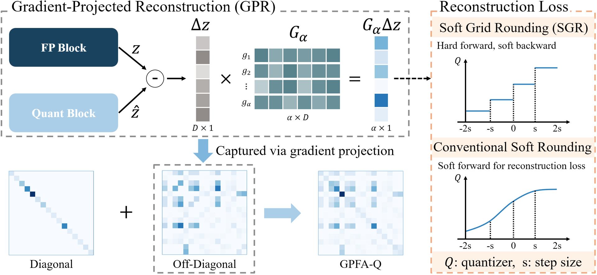

## GPFA-Q: Post-Training Quantization with Gradient-Projected Fisher Approximation for Vision Transformers

This repository contains the official PyTorch implementation of the NeurIPS 2026 paper "Post-Training Quantization with Gradient-Projected Fisher Approximation for Vision Transformers".



## Getting Started

- Clone this repo.

```bash
git clone https://github.com/Nobody-96/GPFA-Q.git
cd GPFA-Q
```

- Install PyTorch and [timm](https://github.com/huggingface/pytorch-image-models).

```bash
pip install torch==2.2.2 torchvision==0.17.2 --index-url https://download.pytorch.org/whl/cu121
pip install timm==0.9.2 "numpy<2"
```

All experiments were run with Python 3.10, torch 2.2.2 (CUDA 12.1), torchvision 0.17.2 and timm 0.9.2 on a single RTX 4090.

- Prepare ImageNet in the `ImageFolder` layout. `--dataset` points to the directory that contains `train/` and `val/`.

```
<IMAGENET>/
├── train/
│   ├── n01440764/*.JPEG
│   └── ...
└── val/
    ├── n01440764/*.JPEG
    └── ...
```

- Pretrained models are downloaded automatically by timm.

## Usage

The method has two stages. **Calibration** searches the quantization scales on 128 images. **Reconstruction** optimizes each block on 1,024 images. The settings of each bit-width are in `configs/{3,4,6,8}bit/gpfaq.py`.

Example: Calibrate a model.

```bash
python test_quant.py --model vit_small --config ./configs/3bit/gpfaq.py --dataset <IMAGENET> --calibrate
```

This writes `./results/vit_small_w3_a3/seed3407/calib/vit_small_w3_a3_calibsize_128_mse.pth` and reports the accuracy of the calibrated model.

Example: Load the calibrated checkpoint, then run GPFA-Q block reconstruction.

```bash
python test_quant.py --model vit_small --config ./configs/3bit/gpfaq.py --dataset <IMAGENET> \
    --load-calibrate-checkpoint ./results/vit_small_w3_a3/seed3407/calib/vit_small_w3_a3_calibsize_128_mse.pth \
    --optimize --ablation gpfaq --seed 0
```

The reconstructed model is saved as `./results/vit_small_w3_a3/seed0/gpfaq/vit_small_w3_a3_optimsize_1024_gpfaq.pth`.

Example: Load a reconstructed checkpoint and test it.

```bash
python test_quant.py --model vit_small --config ./configs/3bit/gpfaq.py --dataset <IMAGENET> \
    --load-optimize-checkpoint ./results/vit_small_w3_a3/seed0/gpfaq/vit_small_w3_a3_optimsize_1024_gpfaq.pth \
    --test-optimize-checkpoint
```

Ablations (Table 2 of the paper):

| `--ablation` | Table 2 row |
|:---|:---|
| `baseline` | Baseline |
| `gpr` | + GPR |
| `gpfaq` | + SGR (GPFA-Q) |

## Results

The table below lists the GPFA-Q results on ImageNet (top-1 accuracy, %) reported in the paper (Table 1).

| Model | **Full Prec.** | **W4/A4** | **W3/A3** |
|:----------:|:--------------:|:---------:|:---------:|
| **ViT-S**  | 81.39          | 76.67     | 64.68     |
| **ViT-B**  | 84.54          | 83.16     | 77.79     |
| **DeiT-T** | 72.21          | 67.34     | 56.92     |
| **DeiT-S** | 79.85          | 76.93     | 70.26     |
| **DeiT-B** | 81.80          | 80.36     | 76.97     |
| **Swin-S** | 83.23          | 82.07     | 77.74     |
| **Swin-B** | 85.27          | 83.81     | 79.77     |

## Checkpoints

The calibrated (`*_calibsize_128_mse.pth`) and reconstructed (`*_optimsize_1024_gpfaq.pth`) checkpoints of all models in the table are available on the [Releases](https://github.com/Nobody-96/GPFA-Q/releases) page. To evaluate a reconstructed checkpoint:

```bash
python test_quant.py --model vit_small --config ./configs/3bit/gpfaq.py --dataset <IMAGENET> \
    --load-optimize-checkpoint ./vit_small_w3_a3_optimsize_1024_gpfaq.pth --test-optimize-checkpoint
```

A calibrated checkpoint can be passed to `--load-calibrate-checkpoint` to run the block reconstruction.
